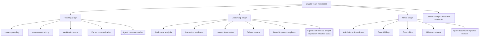

# Claude for Schools

**How I rolled out AI across a whole school, turning a general assistant into
tools built for teachers, leaders and office staff.**

BC Academy International School & Nursery, Dubai · Claude Team plan · 25–60 staff

---

## The problem

Giving staff a chatbot login doesn't change how a school works. Teachers get
generic answers that ignore the UK National Curriculum; office staff can't trust
it with fees or admissions rules; leaders can't use it for inspection work
because it doesn't know the UAE framework.

## What I built

Three **Claude plugins**, one per staff group. Each bundles skills (packaged
expertise and house style), agents (sub-assistants for bigger jobs) and connectors.

| Plugin | Skills | Agents |
|---|---|---|
| **Teaching** | Lesson planning (UK National Curriculum, Dubai context) · assessment writing with mark schemes · marking & report comments in house style · parent emails | Class-set marker: marks a whole class against a rubric and reports common misconceptions |
| **Leadership (SLT)** | Attainment & gap analysis · KHDA inspection readiness (UAE framework) · lesson observation write-ups · policies, briefings, newsletters · branded board and parent templates | Cohort data analyst · inspection evidence scout (maps a Drive folder against the six inspection standards) |
| **Office** | Admissions & enrolment · fees, invoices and KHDA fee rules · front office & attendance · HR, safer recruitment, onboarding | Records compliance checker: finds missing or expiring documents before an inspection or visa round |

Every plugin also includes a **"working with Claude"** skill that explains to staff
when and why it pushes back or asks questions, and what it won't do.

Plus a custom **[Google Classroom connector](https://github.com/ayaz-oss/classroom-mcp-showcase)**
so teachers can read their classes and set work from Claude.

## Design principles

- **Specific, not generic.** Skills encode the UK National Curriculum, KHDA rules
  and the school's brand and tone, so output is usable without rewriting.
- **Honest over agreeable.** Staff are told Claude will question weak data and
  won't invent numbers.
- **Least privilege.** Read-only agents for audits; connectors that create drafts,
  never delete.
- **Templates only on request.** Named templates are used only when a person asks
  for them, never applied automatically.

## My role

Led the rollout with senior leadership: designed the plugin structure, wrote and
tested the skills and agents, built the Classroom connector, and lead staff onboarding.

---

[@ayaz-oss](https://github.com/ayaz-oss)
